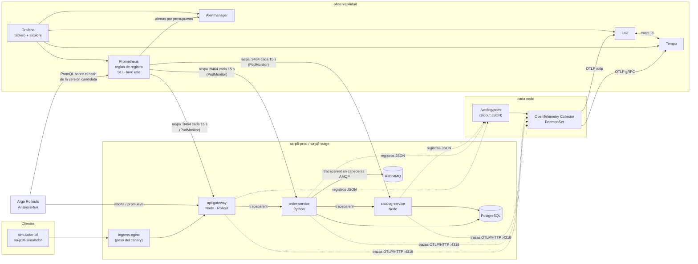
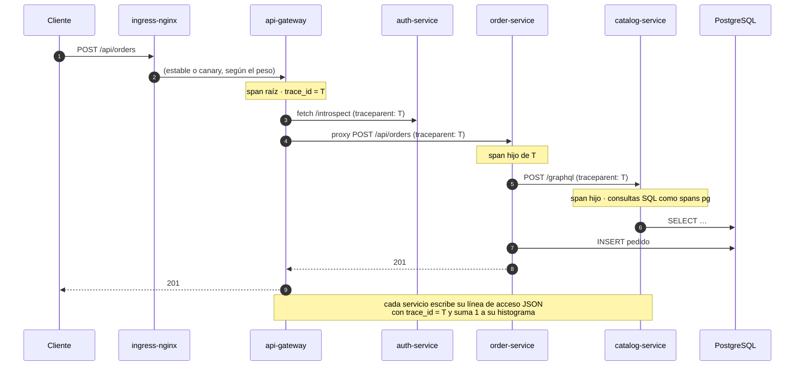

# Flujo de la telemetría: del servicio al tablero y a la alerta

Tres señales salen de cada servicio instrumentado, cada una por un camino
distinto y a propósito. Las tres se vuelven a encontrar en Grafana gracias a
un mismo identificador: el `trace_id`.



## Los tres caminos

| Señal | Cómo sale del servicio | Quién la mueve | Dónde termina | Por qué así |
|---|---|---|---|---|
| **Métricas** | SDK de OpenTelemetry → exportador Prometheus en `:9464/metrics` | Prometheus las **raspa** cada 15 s (PodMonitor `plataforma`) | Prometheus (30 días, disco de 10 Gi) | Gobiernan el canary: no deben depender del Collector. Raspadas, llegan con las etiquetas del pod, incluido `rollouts_pod_template_hash`. |
| **Trazas** | SDK → OTLP/HTTP a `otel-collector:4318` | Collector de **su mismo nodo** (`internalTrafficPolicy: Local`), que añade pod, nodo y namespace | Tempo (72 h) | Lote y reintento fuera del proceso de la aplicación. |
| **Registros** | `stdout`, una línea JSON con `trace_id` y `span_id` | Collector lee `/var/log/pods/sa-p8-*` del nodo, interpreta el JSON y pasa `trace_id` al campo de traza del registro | Loki (7 días) | `kubectl logs` sigue funcionando aunque el stack esté caído; la aplicación no depende de nada para dejar rastro de su fallo. |

## Una petición, de punta a punta



## De la métrica a la alerta

```
http_server_request_duration_seconds_count{service="api-gateway", http_route="/api/orders", ...}
        │  regla de registro, cada 30 s, en 5 ventanas (5m · 30m · 1h · 6h · 30d)
        ▼
slo:checkout_errores:ratio_rate1h          fracción de compras con 5xx
        │  ÷ (1 − 0,995)
        ▼
slo:checkout_disponibilidad:burnrate1h     velocidad de consumo del presupuesto
        │  > 14,4 en 1 h  Y  > 14,4 en 5 min, durante 2 min
        ▼
ALERTS{alertname="CheckoutPresupuestoQuemaRapida", severity="pagina"}
        │  Alertmanager: agrupa por alerta y SLO, inhibe la de quema lenta
        ▼
receptor `guardia` → interfaz de Alertmanager y anotaciones del tablero
        │  runbook_url
        ▼
docs/runbooks/checkout-quema-rapida.md → Tempo → Loki → causa
```

## De la métrica a la decisión del canary

```
Rollout sa-platform-api-gateway, paso setWeight: 10
  └─ AnalysisRun (plantilla sa-p10-metricas)
       args: namespace, servicio=api-gateway,
             hash-canary = podTemplateHashValue: Latest   ← el ReplicaSet nuevo
       cada 1 min, 3 veces:
         tráfico      sum(increase(..._count{…hash…}[2m]))            ≥ 10
         errores      5xx / total  de ese hash                          ≤ 5 %
         latencia     histogram_quantile(0.95, …bucket{…hash…}[2m])  ≤ 0,5 s
       2 mediciones fallidas → Failed → Argo Rollouts aborta:
         todo el tráfico vuelve a la versión estable, la candidata se escala a 0
```
