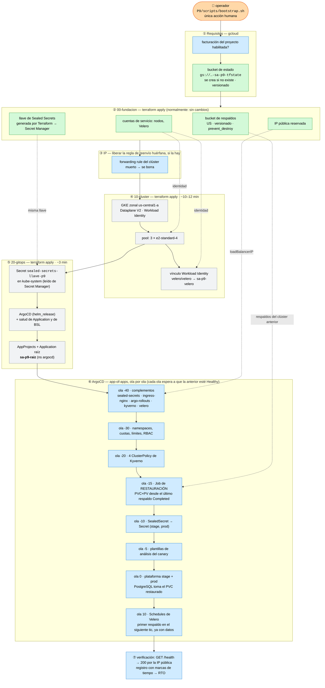
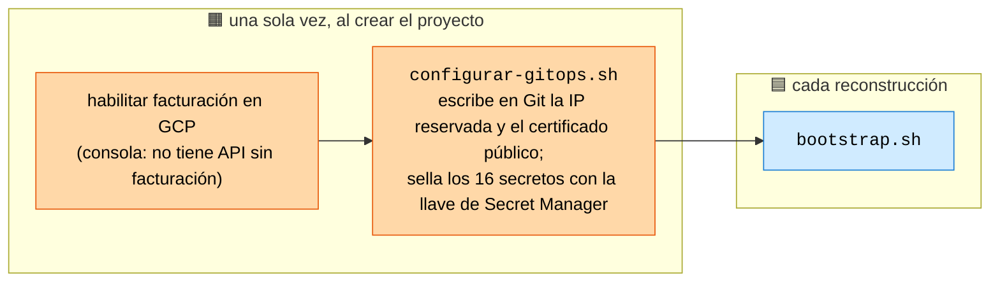
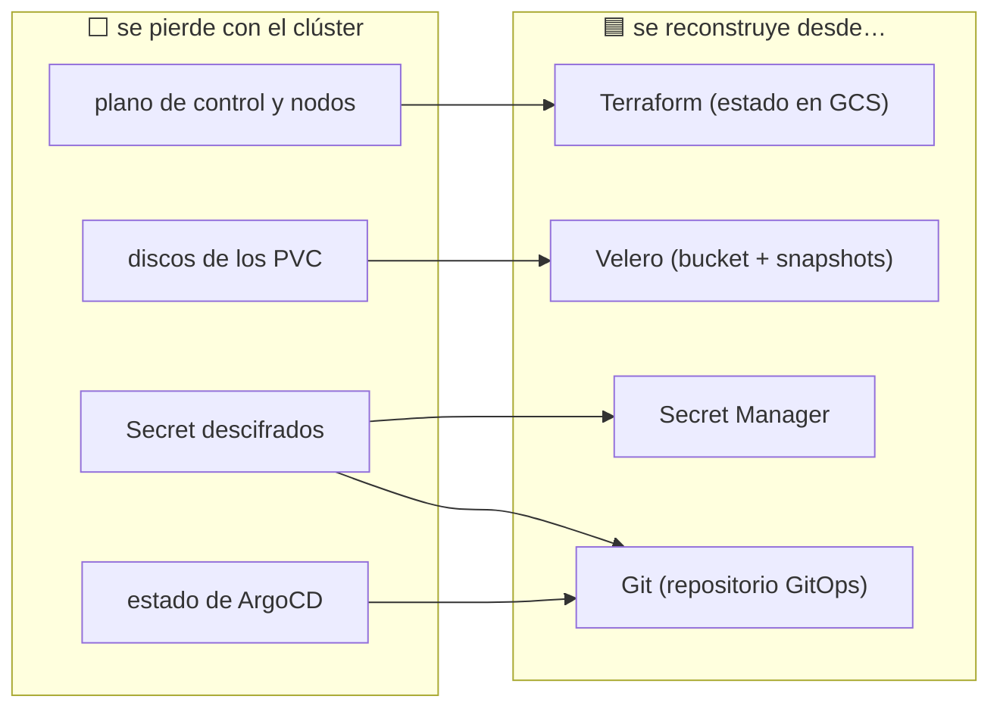

# Diagrama del bootstrap: orden de reconstrucción y dependencias

Un solo comando, `P9/scripts/bootstrap.sh`, y de ahí en adelante nada lo
toca una persona. El diagrama distingue tres cosas, porque el criterio 1.3
pide distinguirlas y porque son tres respuestas distintas a «¿qué hago si
esto falla?»:

| Símbolo | Significa |
|---|---|
| 🟦 **automático** | lo hace el sistema sin intervención |
| 🟧 **manual, una sola vez** | configuración inicial; NO forma parte de la recuperación |
| 🟩 **duradero** | sobrevive al desastre: es con lo que se sale de él |
| ⬜ **desechable** | se pierde en el desastre y se reconstruye |

## 1. La reconstrucción, de principio a fin

## 2. Por qué este orden y no otro

Cada flecha es una dependencia real; romper cualquiera tiene un síntoma
concreto, y casi todos son silenciosos:

| Dependencia | Si se invierte… |
|---|---|
| llave en `kube-system` **antes** que el controlador de Sealed Secrets (⑤ → ola -40) | el controlador genera una llave propia; los 16 SealedSecret del repositorio dejan de abrirse y los pods quedan sin credenciales |
| Velero **Healthy** (bucket `Available`) **antes** de la restauración (-40 → -15) | el Job concluiría «no hay respaldos» solo porque aún no los leyó |
| namespaces **antes** de la restauración (-30 → -15) | los PVC restaurados caerían en namespaces sin cuotas ni etiquetas de Pod Security |
| restauración **antes** de la plataforma (-15 → 0) | el StatefulSet crea un PVC vacío, `initdb` lo inicializa, y Velero ya no restaura encima de un PVC que existe: los datos se pierden por segunda vez |
| políticas **antes** de la plataforma (-20 → 0) | durante unos minutos se admitirían pods sin firma verificada |
| secretos **antes** de la plataforma (-10 → 0) | los pods arrancan en `CreateContainerConfigError` y ArgoCD reintenta |
| plataforma **antes** de los Schedules (0 → 10) | un tic del cron durante la reconstrucción respaldaría los namespaces vacíos y sería «el más reciente» para la siguiente recuperación |

El orden de las olas lo hace cumplir ArgoCD, no la suerte: el script de
salud de `argoproj.io/Application` en `argocd-cm` (`20-gitops/argocd.tf`)
hace que la raíz espere a que cada ola esté `Healthy`. Sin ese script —que
ArgoCD trae apagado desde la versión 1.8—, la raíz aplicaría todas las olas
casi a la vez.

## 3. Lo que es manual, y cuándo

Solo dos cosas, y **ninguna** está en el camino de la recuperación:

Las dos dependen solo de la fundación, que sobrevive al desastre: la IP, la
llave y el certificado son los mismos antes y después de reconstruir. Por eso
`bootstrap.sh` comprueba que el repositorio GitOps ya tenga la IP y, si no,
se detiene en el primer minuto en lugar de dejar un balanceador en
`<pending>` media hora después.

## 4. Qué se pierde y qué no

Lo único que **no** se recupera son las escrituras posteriores al último
respaldo: esa ventana es el RPO, y se mide (ver el informe).
